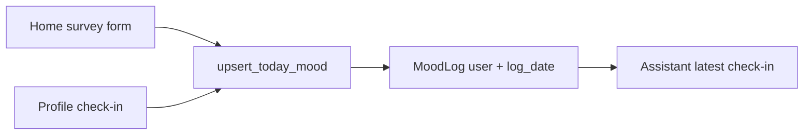

# Mood / energy home survey plan

Plan for adding a **daily mood + energy check-in** at the top of the Top Picks
(recommendation) section on the home page, recorded with the signed-in user’s
data and tracked **one entry per calendar day**. Ranking changes are out of
scope for this pass.

## Problem today

Mood and energy already exist, but not where recommendations live:

| Surface | Behavior |
|---|---|
| `/profile/` “Variable user inputs” | `MoodLogForm` appends a new `MoodLog` on every submit |
| Assistant | Reads latest `MoodLog` in the last 24h (`assistant/profile.py`) |
| Home Top Picks | No check-in UI; likes/not-interested only (login-gated) |
| Top Picks scoring | Ignores mood/energy entirely |

Gaps vs product intent:

1. Check-in is buried on the profile, not next to “Today’s Top Picks.”
2. Append-only logs allow many rows the same day; “per day” is not enforced.
3. Home and profile could diverge if we added a second model or separate write path.

## Goals

1. Put a compact **mood + energy** survey at the **top of the Top Picks block**
   on [`templates/search/home.html`](../templates/search/home.html).
2. **Reuse** [`accounts.MoodLog`](../accounts/models.py) (same 1–5 choices and labels).
3. Enforce **one row per user per America/New_York calendar day**; re-submit
   **updates** today’s row (upsert).
4. **Unify** home and profile writes through one helper so both surfaces stay
   consistent.
5. Keep the assistant’s latest check-in working after the schema change.

## Non-goals (original pass)

- A new survey model separate from `MoodLog`.
- Anonymous / guest persistence (guests see a login prompt only).
- Changing the 1–5 mood/energy choice labels.
- Changing Claude “Picked for you” order (rule-based scoring + tags only).

## Ranking role (shipped)

Mood/energy are **profile-style adjustments** in `score_restaurant()` via
`mood_energy_adjustment()` — not part of the nutrition estimate. See
`md_guides/scoring-algorithm.md` for the delta table. Today's NY `MoodLog` is
passed as `mood_check_in` from `_top_picks` and restaurant detail.

### Cook at home (high mood + high energy)

When today's check-in has **mood ≥ 4 and energy ≥ 4**, `/home/` also shows a
**Cook at home today** strip with a small sample of farmers markets and Shop
Healthy stores (borough from the selected Top Picks area or the user's home
borough), plus a Find food link filtered to those types. This is a separate UI
path in `search/cook_at_home.py` — it does **not** change restaurant
`mood_energy_adjustment` or Top Picks card ranking.

## Locked decisions

| Decision | Choice |
|---|---|
| Storage | Reuse `MoodLog` |
| Daily rule | One row per `(user, log_date)` where `log_date` is NY calendar day |
| Re-submit | Update today’s row in place |
| Ranking | Store + unify only; ranking later |
| Guests | Prompt to log in; no mood rows without auth |

## Design principles

- **One source of truth** for check-ins (`MoodLog`), two entry points (home + profile).
- **Same day boundary as Top Picks** (`America/New_York`, same idea as
  `PICKS_TIME_ZONE` / `_today()` in `search/views.py`).
- **Upsert, don’t append** for “today,” so history is one row per day.
- **Login-gated writes**, same pattern as Like / Not interested.
- **Don’t blend into scoring yet** — collect reliable daily signals first.

## Current model (as shipped)

```python
# accounts.MoodLog — relevant fields today
mood          # 1–5: Awful … Great
energy_level  # 1–5: Exhausted … Energized
created_at    # auto_now_add, indexed; ordering = -created_at
# No unique-per-day constraint; every profile POST inserts a new row
```

Form: `MoodLogForm` (`accounts/forms.py`) — `RadioSelect` for both fields.
Profile POST: `action=log_mood` in `accounts.views.profile` → `save()` append.

## Proposed data model

### Schema

Add to `MoodLog`:

| Field | Type | Notes |
|---|---|---|
| `log_date` | `DateField` | NY calendar day for the check-in; required after migration |
| `updated_at` | `DateTimeField(auto_now=True)` | Optional but recommended so edits are visible without rewriting `created_at` |

Constraints:

- `UniqueConstraint(fields=["user", "log_date"], name="…")`
- Keep `ordering = ["-log_date", "-created_at"]` (or equivalent) so profile
  history lists recent **days**.

On update: change `mood` / `energy_level`; leave original `created_at`; bump
`updated_at`.

### Shared write helper

Introduce something like `accounts/mood.py` (or a model method):

```python
def upsert_today_mood(user, mood, energy_level, *, when=None) -> MoodLog:
    """Create or update today's MoodLog for user (America/New_York day)."""
    day = (when or timezone.now()).astimezone(NYC_TZ).date()
    log, _ = MoodLog.objects.update_or_create(
        user=user,
        log_date=day,
        defaults={"mood": mood, "energy_level": energy_level},
    )
    return log
```

Both profile `log_mood` and the home survey POST call this helper (after
`MoodLogForm` validates). Do not call `MoodLogForm.save()` in a way that
inserts a second row for the same day.

### Data migration

1. Add nullable `log_date` (+ `updated_at` if chosen).
2. Backfill: `log_date = created_at.astimezone(America/New_York).date()`.
3. Collapse duplicates for the same `(user, log_date)`: **keep the latest**
   (`created_at` max); delete older same-day rows.
4. Set `log_date` non-null; add unique constraint.

### Assistant compatibility

`preferences()` currently uses `created_at__gte=now-24h`. After upsert:

- Prefer today’s NY `log_date` when present, **or** keep the 24h window on
  `updated_at` / `created_at` so a morning check-in still counts later the same day.
- Document the chosen rule in tests (`assistant/tests.py`).

Recommended for this pass: treat “latest check-in” as the most recent row with
`log_date == today (NY)` if any, else fall back to latest row with
`updated_at` (or `created_at`) within 24h — so editing today’s survey still
feeds the assistant.

## UI / product

### Placement

Above the Top Picks header / grid in `templates/search/home.html` — still
inside the recommendation section so it reads as part of “today’s picks,” not
a separate page chrome.

### Authenticated

1. **No check-in for today:** compact form — “What is your mood?” / “What is
   your energy?” using the existing choice labels, Submit / Save.
2. **Already checked in today:** show today’s mood + energy labels and an
   **Edit** control that reveals the same form (POST upserts).
3. CSRF + POST to a dedicated endpoint (preferred) or a `home` POST branch
   with `action=log_mood` / `next` redirect back to the current path (preserve
   borough query).

### Guests

Short muted line + link to login (and signup if the site already links it),
same spirit as hiding Like / Not interested for anonymous users. No session
stash of mood.

### Profile

Switch `log_mood` from append to `upsert_today_mood`. History list becomes
“recent days” (naturally after unique-per-day). Copy can keep “daily check-in.”

### Styling

Reuse homepage CSS (`static/search/homepage.css` or equivalent): one compact
band above the picks grid; radio groups consistent with profile; avoid a heavy
card treatment unless needed for the form interaction.



## Migration plan

### Phase 0 — Document (this file)

- [x] Lock storage (reuse `MoodLog`), daily upsert, unify home + profile, no ranking
- [x] Record current touchpoints and non-goals

### Phase 1 — Schema + migration

- [x] Add `log_date` (+ `updated_at`) on `MoodLog`
- [x] Data migration: backfill NY dates; collapse same-day duplicates (keep latest)
- [x] Unique constraint on `(user, log_date)`
- [x] Model admin / list display updated if useful

### Phase 2 — Shared upsert + profile

- [x] Add `upsert_today_mood` helper
- [x] Profile `log_mood` uses upsert (not append)
- [x] Update `accounts/tests.py` for one-row-per-day and update-in-place

### Phase 3 — Home survey UI + POST

- [x] Login-required POST endpoint (e.g. `search:mood_checkin` or accounts URL)
- [x] Context on `home`: today’s log (if any) for authenticated users
- [x] Form + checked-in / edit states in `home.html` above Top Picks
- [x] Homepage CSS for the survey band
- [x] Guests: login prompt only

### Phase 4 — Assistant + tests + docs

- [x] Confirm / adjust `assistant/profile.py` latest-check-in rule for upsert + NY day
- [x] Tests: uniqueness, home + profile upsert, login gate, NY day boundary
- [x] Cross-link from `scoring-algorithm.md` / `ranking-v2-plan.md`: mood is stored
      for personalization later, not in the score yet

## Code touchpoints

| Area | Files |
|---|---|
| Model / migration | `accounts/models.py`, new `accounts/migrations/…` |
| Shared write path | `accounts/mood.py` (new) and/or helpers on `MoodLog`; `accounts/views.py` |
| Form reuse | `accounts/forms.py` (`MoodLogForm`) |
| Home UI + POST | `templates/search/home.html`, `search/views.py`, `search/urls.py`, homepage CSS |
| Profile UI | `templates/accounts/profile.html` (copy only if needed) |
| Assistant | `assistant/profile.py`, `assistant/tests.py` |
| Tests | `accounts/tests.py`; home/check-in tests under `search/` or `accounts/` |
| Docs | this file; optional note in `md_guides/scoring-algorithm.md` |

## Risks

- **Duplicate collapse:** users with multiple same-day historical logs lose older
  same-day rows; keep the latest by `created_at` and document in the migration.
- **Timezone edges:** late-night UTC inserts must key off NY date, not UTC date,
  or “today” flips wrong relative to Top Picks rotation.
- **Assistant 24h window vs calendar day:** a check-in at 11pm then reading at
  1am next NY day should follow the documented rule (prefer calendar-day “today”
  over a raw 24h filter alone).
- **Double forms:** home and profile both posting without the shared helper
  could race; unique constraint makes the second writer update, not duplicate.

## Success criteria

- Authenticated user can set mood + energy from the home Top Picks section.
- Second submit the same NY day updates the same row; DB enforces uniqueness.
- Profile check-in writes the same row as the home survey for that day.
- Guests cannot create mood rows; they see a login prompt.
- Assistant still receives a sensible latest check-in string when one exists.
- Top Picks scores and ordering are unchanged in this pass.

## Open questions (defer)

1. Exact home layout: always-visible radios vs collapsed “Edit” after save.
2. Whether to show a short streak / “checked in today” badge beyond the summary.
3. When ranking lands: how mood vs energy should shift cuisine / calorie priors
   (track as a follow-up to `ranking-v2-plan.md`).

## References

- Ranking / scoring (no mood terms yet): `md_guides/scoring-algorithm.md`,
  `md_guides/ranking-v2-plan.md`
- Model + form: `accounts/models.py`, `accounts/forms.py`
- Profile write path: `accounts/views.py`
- Top Picks day boundary: `search/views.py` (`PICKS_TIME_ZONE`, `_today`)
- Assistant check-in: `assistant/profile.py`
