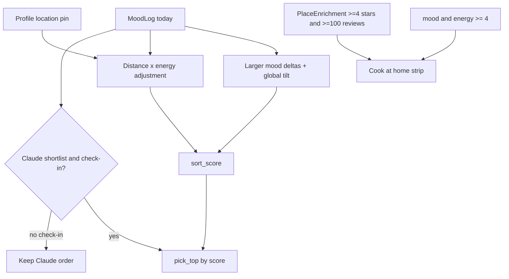

# Ranking update: mood impact, location pin, distance-by-energy, cook-at-home quality filter

Plan for the next ranking / home-recommendation pass. Builds on shipped mood
check-ins, cook-at-home, and Find food maps. Related docs:
[`scoring-algorithm.md`](scoring-algorithm.md),
[`scoring-pipeline.md`](scoring-pipeline.md),
[`mood-energy-survey-plan.md`](mood-energy-survey-plan.md).

**Status legend:** `[ ]` not started · `[~]` in progress · `[x]` done

**Implementation order (locked):** Feature **4 → 1 → 2 → 3**.

---

## Goals

1. Make **mood / energy** change Top Picks order in a way users notice.
2. Let users set a **precise location** (pin on a minimap), not only free-text
   home address / borough dropdown.
3. Use that location so **low energy prefers closer places**; **high energy**
   treats near and far more equally.
4. On cook-at-home suggestions, **drop** farmers markets and Shop Healthy
   stores with Google rating **&lt; 4★** or review count **&lt; 100**.

## Non-goals (this pass)

- Replacing rule-based Top Picks with a full ML ranker.
- Requiring GPS for guests (geolocation only helps place the pin when logged in).
- Changing inspection grade rules or MenuStat calorie math.
- Mixing markets/stores into restaurant Top Picks cards.
- Applying the ≥4★ / ≥100 filter to the full Find food browse list (cook-at-home
  only in this pass).
- Live Google enrich on every cook-at-home miss (document `enrich_places` instead).

---

## Locked decisions

| Question | Decision |
|---|---|
| Claude vs mood scores | When a mood check-in exists, **re-sort** scored picks with `pick_top` (Claude may still shortlist / supply `ai_reason`, but final order follows `score_restaurant`). |
| Missing PlaceEnrichment for markets/stores | **Strict exclude** from cook-at-home (no rating/count → out). |
| Find food quality filter | **Cook-at-home only** this pass. |
| Pin vs `home_address` | Pin lat/lng is the source for **distance**. `home_address` ZIP/boro still feeds personal-fit “Nearby” unless we later unify. |
| Mid energy (3) + no check-in | Distance: mild near-bonus only when pin exists and energy is 3; **no** distance term without pin/check-in energy. |
| NYC bounds | Reuse `search.find_food.NYC_LATITUDE_RANGE` / `NYC_LONGITUDE_RANGE` / `in_nyc`. |

---

## Current behavior (baseline)

| Area | Today |
|---|---|
| Mood / energy | `mood_energy_adjustment()` adds absolute points after the weighted blend (e.g. +5 light, −4 heavy). Cuisine-list gated. Neutral **3** = no change. |
| Why ranking feels unchanged | Deltas (±3…±5) drown under nutrition/safety; only listed cuisines move; Claude path sets `ranked_by_claude` and **returns Claude order** without `pick_top`. |
| Location | Profile `home_address` → ZIP/boro (`home_zip_boro`). Nearby personal fit +0.1. Find food already has `lat`/`lng`. |
| Distance in ranking | Not in `score_restaurant`. |
| Cook-at-home | Borough + open-today; no Google quality gate (`search/cook_at_home.py`). |
| Enrichment | `PlaceEnrichment.rating` / `user_rating_count` keyed by `(kind, key)` with `farmers_market_key` / `grocery_key`. |

---

## Feature 4 — Filter low-review / low-rated markets and Shop Healthy stores

**Status:** `[x]` done

### Spec

```text
MIN_STORE_RATING = 4.0
MIN_STORE_REVIEWS = 100

passes_place_quality(rating, review_count) ->
    rating is not None
    and review_count is not None
    and float(rating) >= 4.0
    and int(review_count) >= 100
```

**Lookup:** For each candidate market/store, load
`PlaceEnrichment` where `kind`/`key` match
`farmers_market_key(year, name, street)` or
`grocery_key(name, street, zip)`. Batch-fetch with
`filter(kind__in=..., key__in=...)` to avoid N+1.

**Pipeline in `cook_at_home_picks`:**

1. Load latest-year markets / all HealthyStores (borough filter as today).
2. Attach enrichment rating/count (None if missing).
3. Keep only `passes_place_quality`.
4. Prefer open-today among remaining markets; `daily_sample` as today.
5. If zero pass, return empty lists; home still shows CTA when mood gate is on.

**Files:**

| Change | File |
|---|---|
| Constants + `passes_place_quality` + batch lookup | `search/cook_at_home.py` (or tiny `search/place_quality.py` imported there) |
| Tests: above/below/missing enrichment | `search/test_cook_at_home.py` |
| Doc note | this file + short note under cook-at-home in mood plan |

**Tests:**

- Market with 4.2 / 150 → eligible; 3.9 / 200 → out; 4.5 / 99 → out; no enrichment → out.
- Borough filter still applies after quality filter.
- Home high/high with only bad enrichment → section show=True, lists empty, CTA present.

### Checklist

- [x] `passes_place_quality` + constants
- [x] Batch enrichment join in market/store samplers
- [x] Filter before sample
- [x] Unit + home tests
- [x] Progress log

---

## Feature 1 — Stronger mood / energy impact on rankings

**Status:** `[x]` done

### Spec — larger cuisine / menu deltas

Replace current constants in `search/recommend.py` with (starting values; adjust
only if tests need a smaller nudge):

| Constant | Old | New |
|---|---|---|
| `ENERGY_LIGHT_BONUS` | 5 | **12** |
| `ENERGY_HEAVY_PENALTY` | −4 | **−10** |
| `ENERGY_HEARTY_BONUS` | 3 | **8** |
| `ENERGY_MENU_LIGHT_BONUS` | 3 | **8** |
| `ENERGY_MENU_HEAVY_PENALTY` | −3 | **−8** |
| `MOOD_COMFORT_BONUS` | 5 | **12** |
| `MOOD_FRESH_BONUS` | 3 | **8** |

### Spec — global tilt (every scored place when check-in exists)

Add after cuisine-specific rows in `mood_energy_adjustment` (or a sibling helper
called from `score_restaurant`):

```text
# nutrition_0_1 = calorie_score if linked else None; if None, skip menu part of tilt
if energy <= 2:
    global += 6 * (nutrition_0_1 - 0.5)   # when menu linked only
    global += 2                            # small flat “prefer easier/lighter day”? 
      # Prefer: only nutrition-linked term above; plus:
    if nutrition is None:
        global += 3 * (prior_health - 0.5)  # needs prior passed in OR compute inside score_restaurant
elif energy >= 4:
    global += 1.5 * (nutrition_0_1 - 0.5)  # weak; or 0 for high energy
```

**Simpler locked v1 (easier to test):**

Inside `score_restaurant`, after `mood_energy_adjustment`:

```text
if mood_check_in and energy <= 2:
    # prefer healthier nutrition estimate
    tilt = 8.0 * (nutrition - 0.5)   # nutrition already 0..1 menu or prior
    score += tilt; record adjustment row "Low energy prefers healthier picks"
elif mood_check_in and energy >= 4:
    tilt = 2.0 * (nutrition - 0.5)   # mild
    score += tilt; optional row
if mood_check_in and mood <= 2:
    # slight comfort: reduce penalty on unhealthy prior already handled by cuisine;
    # add flat +2 to UNHEALTHY_CUISINES / comfort list already gets MOOD_COMFORT
    pass  # cuisine bonuses enough if scaled up
if mood_check_in and mood >= 4 and energy < 4:
    tilt_mood = 3.0 * (nutrition - 0.5)
```

**Locked v1 global tilt (implement exactly this):**

```text
energy = check_in.energy_level
if energy <= ENERGY_LOW:
    score += 10.0 * (nutrition - 0.5)   # ±5 points
elif energy >= ENERGY_HIGH:
    score += 2.0 * (nutrition - 0.5)    # ±1 point
# mood-only global: if mood <= MOOD_LOW and energy > ENERGY_LOW:
#   no extra global (comfort cuisine bonus already scaled)
# if mood >= MOOD_HIGH:
#   score += 4.0 * (nutrition - 0.5) when energy is not already low
#     (avoid double-counting with low-energy tilt: apply mood high only if energy > 2)
```

Tags: if `abs(tilt) >= 1`, add `"Fits your energy"` when energy-driven.

### Spec — Claude order

In `_top_picks` (`search/views.py`):

```text
# After scoring all picks:
if ranked_by_claude and mood_check_in is not None:
    return pick_top(picks, count)   # score order wins
if ranked_by_claude:
    return picks[:count]            # unchanged when no check-in
return pick_top(picks, count)
```

Preserve `ai_reason` on picks when present.

### Files

| Change | File |
|---|---|
| Constants + global tilt in `score_restaurant` / mood helper | `search/recommend.py` |
| Re-sort when check-in + Claude | `search/views.py` |
| Tests for delta magnitude + order flip | `search/test_recommend.py` |
| Claude+mood uses pick_top | `search/test_daily_feedback.py` or assistant tests |
| Docs | `scoring-algorithm.md` mood table; this plan |

### Acceptance

- Unit: salad vs burger score gap under energy=1 grows vs energy=5.
- Unit: global tilt alone moves two equal places when nutrition differs.
- View/unit: with mood check-in, Claude shortlist is reordered by score.

### Checklist

- [x] Scale cuisine/menu mood constants
- [x] Global nutrition×energy tilt in `score_restaurant`
- [x] Claude + check-in → `pick_top`
- [x] Tests
- [x] Update scoring-algorithm mood table
- [x] Progress log

---

## Feature 2 — User location via minimap pin

**Status:** `[x]` done

### Spec — data model

On `accounts.UserProfile`:

```text
location_lat = FloatField(null=True, blank=True)
location_lng = FloatField(null=True, blank=True)
location_updated_at = DateTimeField(null=True, blank=True)
```

Clear pin: POST with empty / `clear=1` sets both null.

### Spec — API

`POST /mood-checkin/` stays mood-only.

New: `POST /location/` → `search:save_location` (login_required):

```text
lat: float, lng: float
→ 200 JSON {ok, lat, lng} if in_nyc
→ 400 if missing/invalid/out of bounds
clear=1 → clears pin, 200 {ok, cleared: true}
```

CSRF as other POSTs. Optional `next` redirect for no-JS form fallback.

### Spec — helper

`search/user_location.py`:

```text
user_latlng(user) -> (lat, lng) | None
  # profile.location_lat/lng if both set and in_nyc
```

### Spec — UI

On `templates/search/home.html`, inside/near mood check-in (logged-in only):

- Title: “Your location”
- Div `#location-minimap` (~220px tall, full width of check-in card)
- MapLibre CDN (same version as Find food: 5.6.1) loaded only on home when authenticated
- Draggable marker; click map to move; “Use my location” button
- On drag end / geo success → `fetch` POST `save_location`
- Show saved coords summary (“Pin saved”) or “Drop a pin for closer picks”
- Guests: short line “Log in to set your location for distance-aware picks”

Default map center: existing pin, else NYC City Hall ~`40.7128, -74.0060`, zoom 11.

### Files

| Change | File |
|---|---|
| Fields + migration `0005_...` | `accounts/models.py`, `accounts/migrations/` |
| `user_latlng`, validation | `search/user_location.py` |
| `save_location` view + url | `search/views.py`, `search/urls.py` |
| Minimap JS | `search/static/search/location_pin.js` |
| Home markup + MapLibre CSS/JS | `templates/search/home.html` |
| Styles | `search/static/search/homepage.css` |
| Tests | `search/test_user_location.py` |

### Acceptance

- Save in-bounds pin persists across reload.
- Out-of-bounds rejected; DB unchanged.
- Clear works.
- Anonymous cannot POST (302 login).

### Checklist

- [x] Migration + model fields
- [x] `user_latlng` + `in_nyc` validation
- [x] `save_location` endpoint
- [x] Minimap UI + JS
- [x] Tests
- [x] Progress log

---

## Feature 3 — Distance weighting by energy

**Status:** `[x]` done

### Spec — curves (points added to sort_score)

Use `restaurants.places.distance_m` → miles (`/ METERS_PER_MILE`).

```text
def distance_energy_adjustment(distance_mi, energy):
    if distance_mi is None or energy is None:
        return 0.0, [], []
    if energy <= 2:
        # strong near preference
        delta = 12.0 * math.exp(-distance_mi / 0.75) - 3.0
        # ≈ +9 at 0 mi, ≈ 0 near 1.5 mi, negative farther
    elif energy >= 4:
        delta = 3.0 * math.exp(-distance_mi / 2.5)
        # ≈ +3 at 0 mi, ≈ +1.3 at 2 mi, gentle
    else:  # energy == 3
        delta = 5.0 * math.exp(-distance_mi / 1.2) - 1.0
    delta = max(-8.0, min(12.0, delta))
    ...
```

Tag `"Closer for your energy"` when `energy <= 2` and `distance_mi <= 1.0` and
delta > 0.

### Spec — wiring

`score_restaurant(..., user_lat=None, user_lng=None, place_lat=None, place_lng=None)`:

1. If any coord missing → skip distance term.
2. Else compute miles; call `distance_energy_adjustment` with
   `mood_check_in.energy_level` (if no check-in, **skip** distance term in v1 —
   energy-aware only).
3. Add to `score`; append adjustment rows after mood rows.

`_top_picks` / `score_for_camis`:

- `user_lat, user_lng = user_latlng(request.user)`
- `place_lat/lng` from Google lookup dict if present, else
  `PlaceEnrichment` / `LocationLookup` for that camis when available.

### Files

| Change | File |
|---|---|
| `distance_energy_adjustment` + integrate | `search/recommend.py` |
| Pass coords | `search/views.py` |
| Tests | `search/test_recommend.py` |
| Docs | `scoring-algorithm.md`, `scoring-pipeline.md` |

### Acceptance

- Identical restaurants: closer scores higher under energy=1 than under energy=5
  for the same pair gap.
- Gap(0.5 mi, 2 mi) under low energy **> 2×** gap under high energy.
- No coords → scores match pre-Feature-3.

### Checklist

- [x] Adjustment function + clip
- [x] `score_restaurant` params + breakdown
- [x] View wiring (user pin + place coords)
- [x] Tests
- [x] Docs
- [x] Progress log

---

## End-to-end flow (after all four)



---

## Suggested implementation order

1. **Feature 4** — quality filter (this session first).
2. **Feature 1** — mood impact + Claude re-sort.
3. **Feature 2** — location pin.
4. **Feature 3** — distance × energy.

---

## Code map

| Module | Role |
|---|---|
| `search/cook_at_home.py` | Feature 4 quality filter |
| `search/recommend.py` | Features 1 + 3 scoring |
| `search/views.py` / `home.html` | Claude re-sort; pin UI; pass lat/lng |
| `accounts/models.py` | `location_lat` / `location_lng` |
| `search/user_location.py` | Feature 2 helper |
| `community.models.PlaceEnrichment` | Ratings for Feature 4; coords for Feature 3 |
| `restaurants/places.py` | `distance_m` |
| `md_guides/scoring-algorithm.md` | Ship notes for mood + distance |

---

## Progress log

| Date | Note |
|---|---|
| 2026-11-16 | Plan created; all four not started. |
| 2026-11-16 | Plan expanded: locked decisions, exact constants, file-level steps, test acceptance. Starting Feature 4. |
| 2026-11-16 | Feature 4 done: `passes_place_quality`, enrichment join, cook-at-home filter + tests. Starting Feature 1. |
| 2026-11-16 | Feature 1 done: larger mood deltas, global nutrition tilt, Claude re-sort with check-in. Starting Feature 2. |
| 2026-11-16 | Feature 2 done: profile pin fields, `/location/` POST, MapLibre minimap on home. Starting Feature 3. |
| 2026-11-16 | Feature 3 done: `distance_energy_adjustment` wired into `score_restaurant` + Top Picks/detail. All four features shipped. |
| 2026-11-16 | Fix: inject mood/energy cuisine extras into Top Picks pool so low vs high check-ins can change Top 3 (pool was too uniform). No Claude API required for ranking. |
| 2026-11-16 | Location minimap UI disabled on home (scripts/markup hidden); `save_location` + profile pin fields kept for later. |
