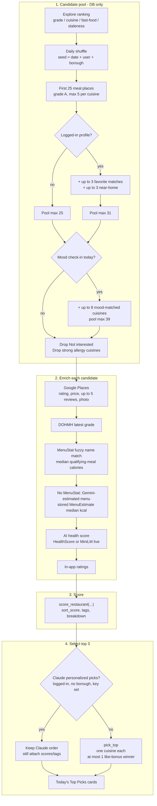
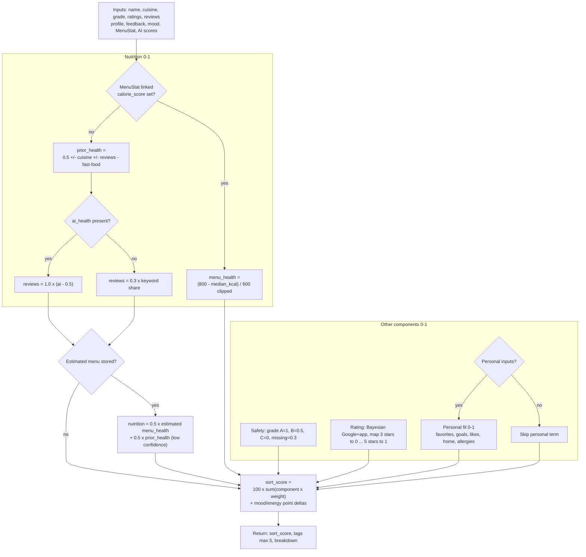
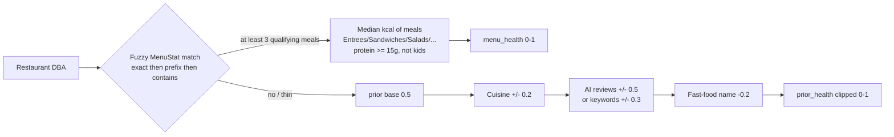
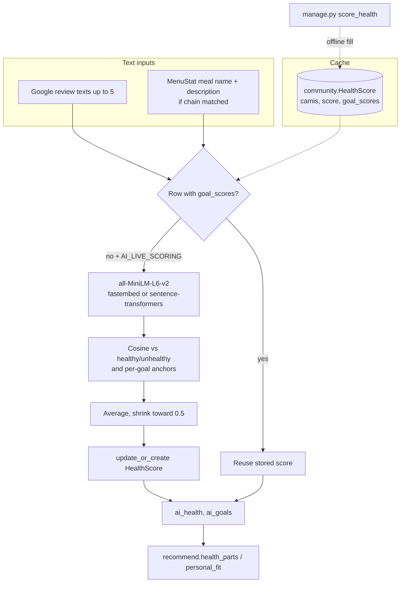
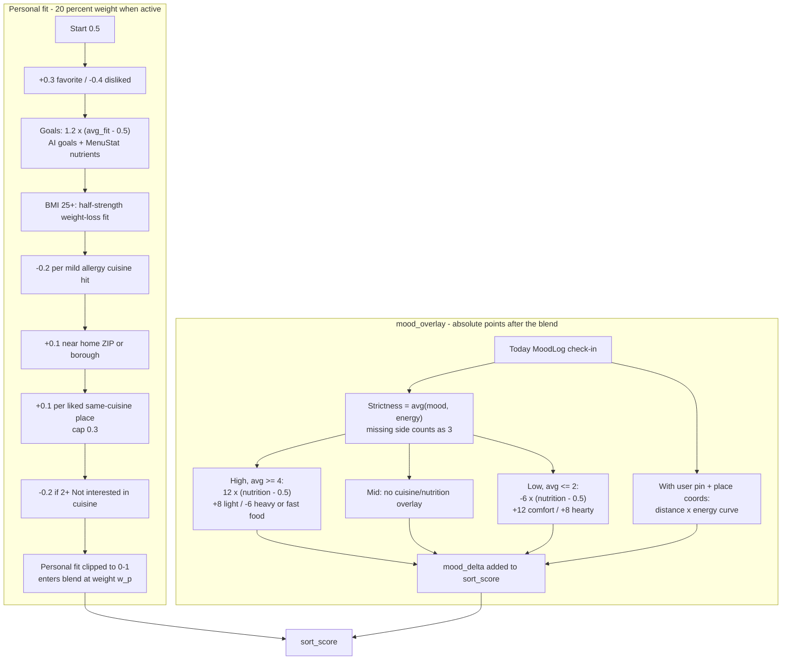

# Restaurant scoring pipeline

End-to-end view of how Today's Top Picks and restaurant detail pages get a
score. **Shipped math and tables:** [`scoring-algorithm.md`](scoring-algorithm.md).
**Design history:** [`ranking-v2-plan.md`](ranking-v2-plan.md).

Core API: pure `score_restaurant()` in `search/recommend.py` (no I/O). Wiring
and enrichment live in `search/views.py`.

---

## 1. End-to-end Top Picks pipeline



**Explore more** uses only step 1's cheap `explore_score` (no Google / MenuStat /
AI). Top Picks re-scores the enriched pool with the full formula.

**Detail page** (`/restaurant/<camis>/`) skips the pool: `score_for_camis` loads
Google / MenuStat / AI / ratings for one place, then calls the same
`score_restaurant`.

---

## 2. Score calculation



### Formula

```text
sort_score =
  100 × (nutrition × w_n + safety × w_s + rating × w_r [+ personal × w_p])
  + mood_overlay (2H: high→healthier, low→laxer)
```

| Mode | Nutrition / prior | Safety | Rating | Personal |
|---|---|---|---|---|
| Linked (MenuStat) | 70% | 20% | 10% | — |
| Linked + health focus | 75% | 15% | 10% | — |
| Unlinked | 40% | 40% | 20% | — |
| Unlinked + health focus | 55% | 30% | 15% | — |
| Any + personal inputs | base × 0.80 | | | 20% |

**Health focus:** BMI ≥ 25 or `weight-loss` goal (BMI is never shown; it only
shifts weights).

**Health estimate** (detail headline, not the sort total):

```text
if MenuStat linked:  100 × menu_health
else:                100 × prior_health
```

Shown with confidence: **high** (exact match, ≥5 meals, year ≥ 2019) /
**medium** (fuzzy/stale/thin menu) / **low** (prior only).

---

## 3. Nutrition path in detail



Qualifying meal filters and match rules: `search/menustat.py`.

---

## 4. AI health score path (not an LLM API)

Numeric store health scores use **MiniLM sentence embeddings**, not Gemini or
Claude. Gemini's only effect on scores is the offline estimated-menu calories
(blended into nutrition when there is no MenuStat menu); otherwise the LLM
APIs write reason prose / read menus / chat / optional re-order.



| Related LLM | Role | Changes score? |
|---|---|---|
| MiniLM (`search/health_ai.py`) | Health + goal floats 0–1 | Yes — feeds prior / personal fit |
| Gemini (`search/reason_writer.py`) | Detail “why” paragraph | No |
| Gemini (`search/what_to_order.py`) | Reads menu photos for the Menu box (live, not stored) | No |
| Gemini (`search/menu_estimate.py`) | Estimated menu + kcal per dish (offline, stored) | Yes — 50% of nutrition when no MenuStat |
| Anthropic (`assistant/llm.py`) | Chat; optional Claude Top Picks order | Order only when used; still runs `score_restaurant` for tags |

Fallback when AI missing: review **keyword** counts in `health_parts`.

---

## 5. Personal fit and mood (after / beside the blend)



Strong allergy cuisines are **excluded from the candidate pool**, not scored as
a soft penalty. Mood/energy rows appear under `breakdown["adjustments"]`; they
do not change `health_estimate`.

After a check-in, the home page calls `rerank/`, which reapplies
`mood_overlay` to the cached scored pool (no Google / MenuStat / AI calls) and
swaps in new Top Picks cards.

When mood and energy are both ≥ 4, home also shows a separate **Cook at home
today** strip (`search/cook_at_home.py`) with farmers markets and Shop Healthy
stores (Google enrichment must be ≥4★ and ≥100 reviews) — not part of the
restaurant sort score.

With a saved location pin and a mood check-in, restaurant sort scores also get
a **distance × energy** adjustment (low energy favors closer places). See
[`ranking-location-mood-plan.md`](ranking-location-mood-plan.md).

---

## 6. Outputs

```python
score, tags, breakdown = score_restaurant(...)
```

| Field | Use |
|---|---|
| `score` | Top Picks sort key (~0–100+, mood can push above 100) |
| `tags` | Card chips (≤5), fixed `TAG_ORDER` |
| `breakdown["health_estimate"]` | Detail nutrition headline |
| `breakdown["confidence"]` | high / medium / low |
| `breakdown["parts"]` | Weighted lines for the detail ranking UI |
| `breakdown["adjustments"]` | Mood/energy rows |
| `breakdown["reasons"]` | Up to 3 “why this pick” sentences |
| `breakdown["like_bonus"]` / `similar_to` | Diversity + tooltip |

Optional Gemini paragraph (`ReasonBlurb`) is layered on the detail page from
general reasons only — never personal facts, never review text.

---

## 7. Code map

| Step | Module |
|---|---|
| Candidate pool / Explore score | `search/views.py` (`_build_candidate_pool`, `_scored_restaurants`) |
| Google enrichment | `search/services/places.py`, `restaurants/places.py` |
| MenuStat link + calories | `search/menustat.py` |
| Gemini-estimated menus | `search/menu_estimate.py`, `manage.py estimate_menus` |
| MiniLM health / goals | `search/health_ai.py`, `search/ai_scores.py` |
| Pure score | `search/recommend.py` (`score_restaurant`, `health_parts`, `personal_fit`, `pick_top`) |
| Goal nutrient fit | `search/goal_fit.py` |
| Top Picks / detail wiring | `search/views.py` (`_top_picks`, `score_for_camis`) |
| Claude optional order | `assistant/recommend.py` (`personalized_picks`) |
| Gemini reason prose | `search/reason_writer.py` |
| Batch AI scores | `manage.py score_health` |
| Batch Gemini blurbs | `manage.py write_reasons` |

---

## 8. Related docs

| Doc | Contents |
|---|---|
| [`scoring-algorithm.md`](scoring-algorithm.md) | Full tables, tags, MenuStat filters, daily rotation, limits |
| [`ranking-v2-plan.md`](ranking-v2-plan.md) | Why nutrition/safety split and linked vs unlinked weights |
| [`mood-energy-survey-plan.md`](mood-energy-survey-plan.md) | MoodLog check-in UX and storage |
